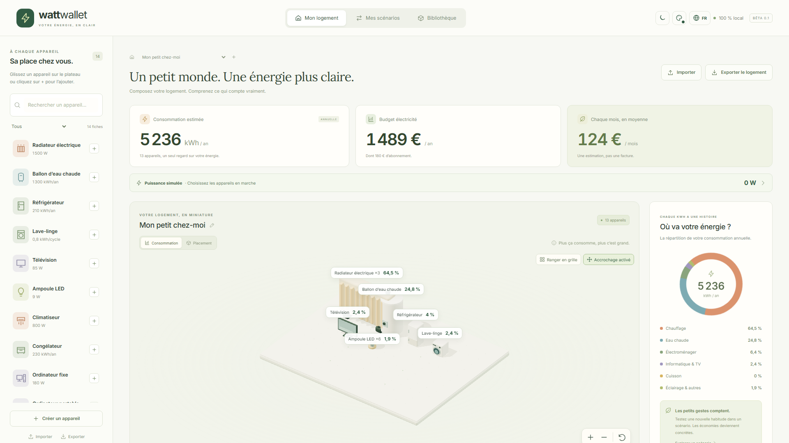
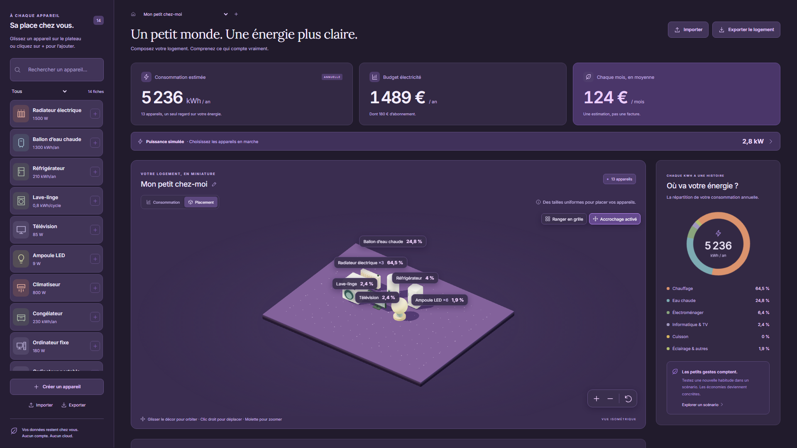

[English](README.md) · [Français](README.fr.md)

# Watt Wallet

Composez votre logement virtuel, comprenez sa consommation électrique et comparez des changements avant d’acheter de nouveaux équipements. Watt Wallet associe une bibliothèque de fiches modifiables, un plateau 3D isométrique et des estimations annuelles. L’application fonctionne localement dans un navigateur ou sous Windows, sans compte, serveur métier ni télémétrie.



## Ce que vous pouvez faire

- Ajouter manuellement vos équipements à partir de 14 fiches génériques modifiables. Regrouper les appareils identiques avec une quantité, ou créer des objets séparés lorsque leurs usages diffèrent.
- Estimer les kWh annuels et le coût électrique à partir de la puissance moyenne et d’une durée, de l’énergie par cycle ou d’une consommation annuelle.
- Organiser le plateau 3D avec le rangement en grille et l’accrochage. Orbiter, déplacer la vue et zoomer ; choisir des tailles uniformes ou des volumes représentant les parts de consommation annuelle.
- Copier la configuration du logement dans des scénarios indépendants. Modifier les équipements, les usages ou les tarifs pour comparer les économies annuelles et le retour simple.
- Simuler les appareils en marche, en veille ou arrêtés pour voir un total indicatif en W/kW. Cette vue est séparée de l’estimation annuelle et ne constitue pas une mesure en direct.
- Créer des fiches par formulaire ou éditeur JSON synchronisé. Partager des fiches, bibliothèques et logements avec scénarios dans des fichiers `.wattpack` autonomes, modèles GLB personnalisés compatibles inclus.
- Choisir le français ou l’anglais, le mode clair ou sombre et une couleur prédéfinie ou personnalisée. Comparer l’estimation de référence à douze mois de consommation saisis depuis vos factures.

Les fiches et les prix fournis sont des **exemples modifiables**, pas des caractéristiques constructeur officielles ni les tarifs actuels d’un fournisseur. Renseignez vos équipements, usages et prix. Les montants restent en euros dans les deux langues.

## Prise en main

Pour la version web en développement, utiliser Node **24.15+ dans la branche 24.x** et npm :

```powershell
npm ci
npm start
```

Ouvrir [http://127.0.0.1:4200](http://127.0.0.1:4200). Le premier lancement crée un logement de démonstration. L’interface démarre en français ; le bouton globe dans l’en-tête permet de choisir **English**.

1. Ajouter ou modifier les appareils et leurs quantités.
2. Renseigner les usages et le tarif avec **Ajuster mon tarif**.
3. Consulter l’estimation annuelle, le budget et la répartition par catégorie.
4. Créer un scénario, modifier un paramètre et comparer avec la **Référence**.
5. Utiliser **Partager le logement** pour créer une sauvegarde transportable.

Pour le développement Windows, installer également Rust stable avec la chaîne MSVC, Visual Studio C++ Build Tools, Windows SDK et WebView2. Exécuter cette commande à la place de `npm start` : Tauri démarre son propre serveur de développement frontend.

```powershell
npm run desktop
```

## Compiler et vérifier

| Commande                | Objectif                                                                                                      |
| ----------------------- | ------------------------------------------------------------------------------------------------------------- |
| `npm run build`         | Compiler la version web dans `dist/watt-wallet/browser`.                                                      |
| `npm run desktop:build` | Compiler l’installateur Windows NSIS dans `src-tauri/target/release/bundle/nsis`.                             |
| `npm test`              | Exécuter les tests unitaires du domaine, du stockage, des échanges, du placement et des services d’interface. |
| `npm run test:e2e`      | Exécuter les parcours Chromium ; installer d’abord son runtime avec `npm exec playwright install chromium`.   |
| `npm run format:check`  | Vérifier le formatage existant des sources et de la documentation de premier niveau.                          |

La version web de production doit être servie sur localhost ou HTTPS, et non ouverte avec `file://`. Après son premier chargement complet et l’installation du service worker, elle peut être rouverte hors connexion sur la même origine. Le mode développement ne met pas l’application en cache pour un usage hors connexion.

L’application Windows fonctionne hors connexion. L’installateur télécharge WebView2 s’il est absent ; cette installation nécessite alors Internet. L’installateur NSIS est actuellement en français ; l’application prend en charge le français et l’anglais. L’installateur n’est pas signé avec un certificat commercial. Le [guide développeur](docs/fr/development.md) détaille les prérequis, les vérifications et le stockage.

## Documentation

| Guide                                                       | Contenu                                                                                       |
| ----------------------------------------------------------- | --------------------------------------------------------------------------------------------- |
| [Guide utilisateur](docs/fr/user-guide.md)                  | Parcours courants, commandes 3D, édition JSON, sauvegardes et dépannage.                      |
| [Calculs et estimations](docs/fr/calculations.md)           | Unités, formules, veille, tarifs, abonnement et exemples de scénarios.                        |
| [Guide développeur](docs/fr/development.md)                 | Installation, architecture, stockage, traduction, compilations, tests et scripts de captures. |
| [Format `.wattpack`](docs/fr/wattpack.md)                   | Contrat version 1, exemples JSON complets, exigences GLB et limites d’import.                 |
| [Vérifications et limites connues](docs/fr/verification.md) | Résultats historiques des validations locales et parcours non testés.                         |

Le [schéma JSON](docs/wattpack.schema.json) et les [paquets d’exemple](examples/) sont inclus dans le dépôt. L’[index des captures](docs/screenshots/README.md) présente les dispositions iPhone, iPad, MacBook et desktop, avec des séries françaises et anglaises pour les trois grands formats. Ces captures Chromium ne constituent pas une certification sur appareils Apple physiques ou Safari.



## Données locales et limites de la V1

Les logements, scénarios et fiches sont sauvegardés automatiquement sur cet appareil : IndexedDB dans le navigateur, fichiers JSON et GLB dans le dossier applicatif Windows. Les données ne sont pas synchronisées entre origines web, profils ou application de bureau. Exporter un `.wattpack` pour transférer ou sauvegarder un logement, et exporter séparément la bibliothèque pour les fiches qui ne sont pas installées dans ce logement. Les préférences de thème et de langue restent sur l’appareil.

La 3D est facultative : la liste et les formulaires restent utilisables sans WebGL. Les estimations utilisent les usages saisis, sans modèle thermique. La V1 n’inclut pas de catalogue en ligne, comptes, intégration Linky, données de compteur en direct, reconnaissance photo, éditeur de géométrie, simulation température/météo ou tarifs calendaires comme Tempo. Les ressources GLB importées puis retirées des fiches peuvent rester dans le stockage local ; aucune commande de compactage n’est encore proposée.
