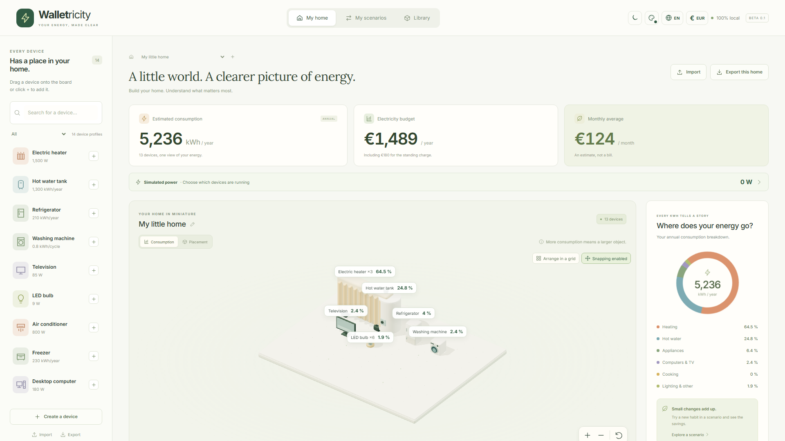
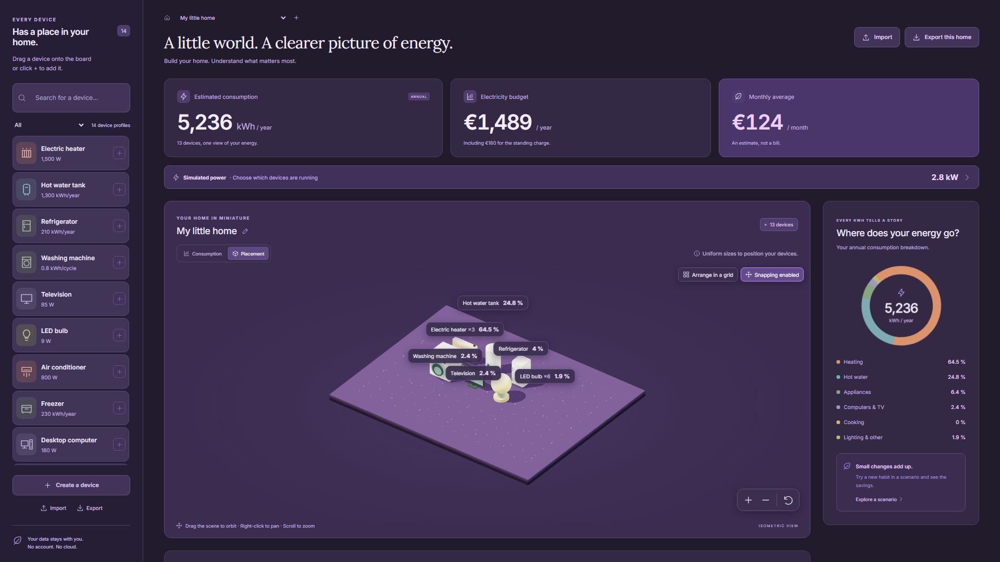

[English](README.md) · [Français](README.fr.md)

# Walletricity

Build a virtual home, understand your electricity use and compare changes before buying new equipment. Walletricity combines an editable device library, an isometric 3D board and annual energy estimates. It runs locally in a browser or as a Windows application, without an account, a backend service or telemetry.



## What you can do

- Add your equipment manually, starting from 14 editable generic profiles. Group identical devices with a quantity, or create separate objects for different uses.
- Estimate annual kWh and electricity costs from average power and duration, energy per cycle or a yearly consumption value.
- Organize the 3D board with grid arrangement and snapping. Orbit, pan and zoom; switch between uniform placement sizes and volumes representing annual consumption shares.
- Duplicate a home configuration into independent scenarios. Change equipment, usage or tariffs and compare annual savings and simple payback.
- Simulate which devices are running, on standby or off to see an indicative W/kW total. This is separate from the annual estimate and is not a live measurement.
- Create device profiles through a form or synchronized JSON editor. Share profiles, libraries and homes with scenarios in standalone `.wattpack` files, including supported custom GLB models.
- Choose French or English, light or dark mode, and a preset or custom accent color. Compare the reference estimate with twelve months of consumption entered from your bills.

The supplied devices and prices are **editable examples**, not official manufacturer specifications or current supplier tariffs. Enter your own equipment, usage and prices. Choose euros (EUR) or US dollars (USD) independently from the interface language; entered amounts are not converted.

## Quick start

For the web development version, use Node **24.15+ on the 24.x branch** and npm:

```powershell
npm ci
npm start
```

Open [http://127.0.0.1:4200](http://127.0.0.1:4200). The first launch creates a demonstration home. The initial interface language is French; use the globe button in the header to select **English**.

1. Add or edit devices and their quantities.
2. Enter usage and your tariff with **Adjust my tariff**.
3. Check the annual energy estimate, budget and category breakdown.
4. Create a scenario, make a change and compare it with **Reference**.
5. Use **Export this home** to make a portable backup.

For Windows desktop development, also install Rust stable with the MSVC toolchain, Visual Studio C++ Build Tools, Windows SDK and WebView2. Run the following instead of `npm start`: Tauri starts its own frontend development server.

```powershell
npm run desktop
```

## Build and check

| Command                 | Purpose                                                                                       |
| ----------------------- | --------------------------------------------------------------------------------------------- |
| `npm run build`         | Build the web app in `dist/watt-wallet/browser`.                                              |
| `npm run desktop:build` | Build the Windows NSIS installer in `src-tauri/target/release/bundle/nsis`.                   |
| `npm test`              | Run domain, storage, exchange, scene-layout and UI-service unit tests.                        |
| `npm run test:e2e`      | Run Chromium journeys; install its runtime first with `npm exec playwright install chromium`. |
| `npm run format:check`  | Check the existing source and top-level documentation formatting.                             |

The production web build must be served over localhost or HTTPS, rather than opened with `file://`. After its first complete load and service-worker installation, it can reopen offline on the same origin. Development mode does not cache the application for offline use.

The Windows application runs offline. The installer downloads WebView2 if it is missing, so that installation path needs an internet connection. The NSIS installer currently uses French; the application itself supports French and English. The installer is not commercially code-signed. See the [developer guide](docs/en/development.md) for complete prerequisites, checks and storage details.

## Documentation

Start with the [documentation introduction](docs/en/index.md). The browser documentation includes a feature sidebar, page contents, local search, language selection and light/dark themes.

```powershell
npm run docs:dev
```

Open [http://127.0.0.1:5173/en/](http://127.0.0.1:5173/en/). Build the standalone site with `npm run docs:build`; see the [publishing instructions](docs/en/development.md#documentation-website) for GitHub Pages.

| Guide                                                    | Contents                                                                         |
| -------------------------------------------------------- | -------------------------------------------------------------------------------- |
| [User guide](docs/en/user-guide.md)                      | Everyday workflows, 3D controls, JSON editing, backups and troubleshooting.      |
| [Calculations and estimates](docs/en/calculations.md)    | Units, formulas, standby, tariffs, standing charges and scenario examples.       |
| [Developer guide](docs/en/development.md)                | Setup, architecture, storage, translation, builds, tests and screenshot scripts. |
| [Design system & Storybook](docs/en/design-system.md)    | Interactive design system, components, themes and isolated fixtures.             |
| [Visual regression](docs/en/visual-testing.md)           | Screenshot comparisons, approved references and difference reports.              |
| [`.wattpack` format](docs/en/wattpack.md)                | Version 1 contract, complete JSON examples, GLB requirements and import limits.  |
| [Verification and known limits](docs/en/verification.md) | Historical local validation results and what has not been tested.                |

The [JSON schema](docs/wattpack.schema.json) and [example packages](examples/) are included in the repository. Browse the [screenshot index](docs/screenshots/README.md) for iPhone, iPad, MacBook and desktop layouts, including French/English series for the three larger viewports. These are Chromium layout captures, not physical Apple-device or Safari certification.



## Local data and V1 boundaries

Homes, scenarios and the device library are automatically saved on this device: IndexedDB in the browser, JSON and GLB files in the Windows application data folder. Data is not synchronized between browser origins, profiles or the desktop app. Export a `.wattpack` to transfer or back up a home, and export your library separately for profiles that are not installed in that home. Theme and language preferences stay on the device.

The 3D view is optional: the device list and forms remain usable without WebGL. The estimates use your stated usage, not a thermal model. The V1 does not include an online catalogue, accounts, Linky integration, live meter data, photo recognition, a geometry editor, temperature/weather simulation or calendar tariffs such as Tempo. Imported GLB resources removed from profiles may remain in local storage; there is no storage compaction command yet.
