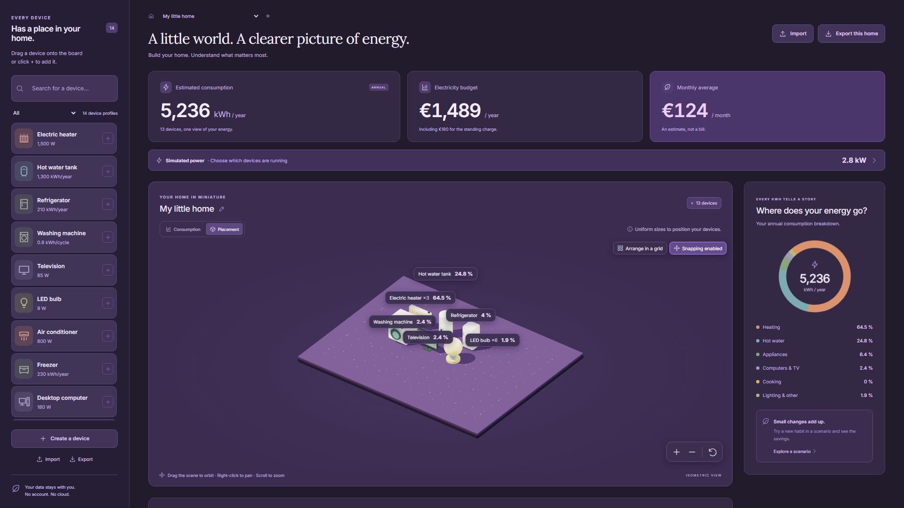

[English](../en/examples.md) · [Français](../fr/examples.md) · [Home](../../README.md)

# Examples and screenshots

## Importable example packages

Download a `.wattpack`, then use **Import** in Walletricity to inspect the preview and add new copies. These are demonstration data, not official equipment profiles. Imports do not replace your existing entries.

| Package                                                           | Contents                                                                                                                   |
| ----------------------------------------------------------------- | -------------------------------------------------------------------------------------------------------------------------- |
| [Generic library](../../examples/bibliotheque.wattpack)           | 14 editable device profiles. [Read the manifest](../../examples/bibliotheque.manifest.json).                               |
| [Home and scenario](../../examples/logement.wattpack)             | Installed equipment and a scenario with reduced heating hours. [Read the manifest](../../examples/logement.manifest.json). |
| [Custom GLB profile](../../examples/modele-personnalise.wattpack) | A minimal standalone triangular model. [Download the GLB](../../examples/triangle.glb).                                    |

The [manifest JSON schema](../wattpack.schema.json) and [format guide](wattpack.md) document the contract and validation limits. User-written names and notes in these examples retain their original French text when opened in English.

## Feature galleries

Each gallery contains 21 viewport PNGs, including annual estimates, 3D, profiles/JSON, scenarios, power, tariffs, sharing and themes.

| Layout          | Dimensions  | English                                             | French                                              |
| --------------- | ----------- | --------------------------------------------------- | --------------------------------------------------- |
| iPad Pro 11″    | 834 × 1194  | [Open](../screenshots/ipad-pro-11/en/index.html)    | [Open](../screenshots/ipad-pro-11/fr/index.html)    |
| MacBook Pro 14″ | 1512 × 982  | [Open](../screenshots/macbook-pro-14/en/index.html) | [Open](../screenshots/macbook-pro-14/fr/index.html) |
| Desktop         | 1920 × 1080 | [Open](../screenshots/desktop/en/index.html)        | [Open](../screenshots/desktop/fr/index.html)        |
| iPhone 16 Pro   | 402 × 874   | [Open](../screenshots/iphone-16-pro/en/index.html)  | [Open](../screenshots/iphone-16-pro/index.html)     |

These captures use Chromium and isolated demonstration data at pixel ratio 1. They show responsive layouts, not validation on physical Apple devices or Safari. [Regenerate the series](development.md#examples-and-feature-screenshots).

## Light and dark

Theme preferences belong to the application on your device. The documentation’s appearance switch is separate.
