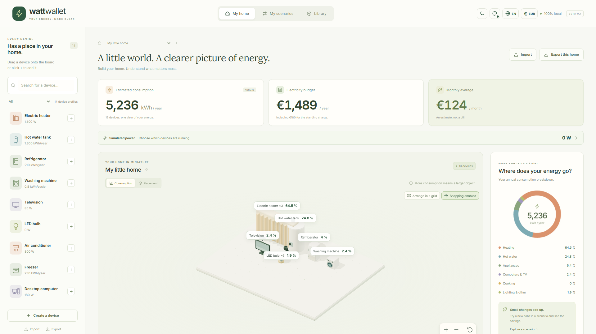

[English](../en/index.md) · [Français](../fr/index.md) · [Home](../../README.md)

# Welcome to Walletricity

**Build your home. Understand what uses electricity. Try changes before making them.**

Walletricity is a local electricity estimator built around a miniature 3D home. Add your own devices, enter their usage and tariff, then compare annual energy and cost. No account, supplier connection or live data is needed.

## Start with your equipment

1. Open the app and create a home, or explore its demonstration home.
2. Add devices from the editable library and adjust their usage and quantities.
3. Enter your price per kWh and annual standing charge.
4. Review the estimate and create a scenario to try a change.
5. Export your home to keep a portable backup.

[Follow the user guide](user-guide.md#your-first-home) or [set up the project locally](development.md#prerequisites-and-setup).

## Explore the features

| Feature                                                               | What you can do                                                                  |
| --------------------------------------------------------------------- | -------------------------------------------------------------------------------- |
| [Equipment and quantities](user-guide.md#add-edit-and-remove-devices) | Group identical devices, duplicate them and remove them from a home or scenario. |
| [Profiles and JSON](user-guide.md#create-a-reusable-profile)          | Create reusable profiles through a form or a validated JSON editor.              |
| [3D board](user-guide.md#organize-and-explore-the-board)              | Orbit, zoom, move devices and arrange an adaptive grid.                          |
| [Tariffs](user-guide.md#enter-your-tariff)                            | Enter Base or peak/off-peak prices and separate standing charges.                |
| [Scenarios](user-guide.md#compare-a-scenario)                         | Compare independent configurations, savings and simple payback.                  |
| [Simulated power](user-guide.md#simulate-devices-running-now)         | Switch devices between running, standby and off for a temporary watts total.     |
| [Bill benchmark](user-guide.md#compare-with-your-bills)               | Compare your reference estimate with twelve months of observed consumption.      |
| [Appearance](user-guide.md#personalize-the-interface)                 | Choose a language, light/dark mode and accent color.                             |
| [Sharing](user-guide.md#share-and-back-up)                            | Export and import a home, scenarios or device library with its custom models.    |

## What the numbers mean

Annual estimates come from average power and duration, energy per cycle or an entered annual value. The power simulator is separate: its switch states never change annual kWh or budgets. The annual standing charge enters the total budget but not device consumption shares.

The 14 supplied profiles and prices are editable examples, not official specifications or current supplier tariffs. Heating hours are explicit assumptions; there is no automatic temperature, weather or insulation model. [Understand the calculations](calculations.md).

## Keep your data local

Homes and profiles are saved automatically on this device. Browser and Windows stores are separate; there is no cloud synchronization. Use `.wattpack` exports to transfer data and keep backups. The [user guide](user-guide.md#saving-and-recovery) explains storage failures and conflicts between windows.

The sidebar takes you to each feature. Local search finds text in this language; the header switches languages or appearance. For downloads and more views, see [examples and screenshots](examples.md). For the code, use the [developer guide](development.md), [exchange format](wattpack.md) and [test coverage and known limits](verification.md).
