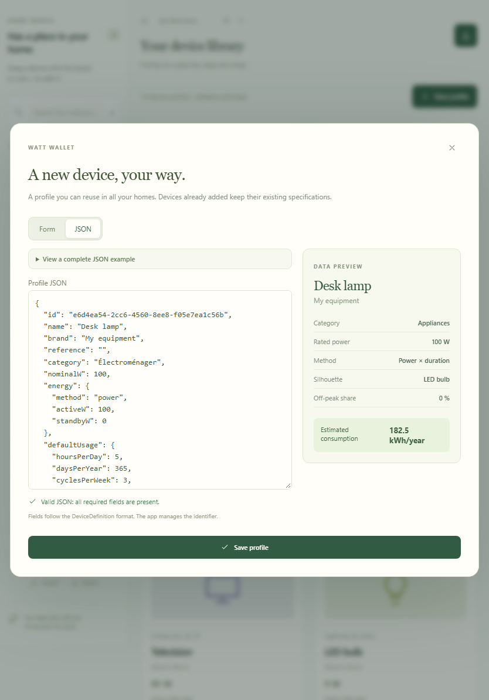
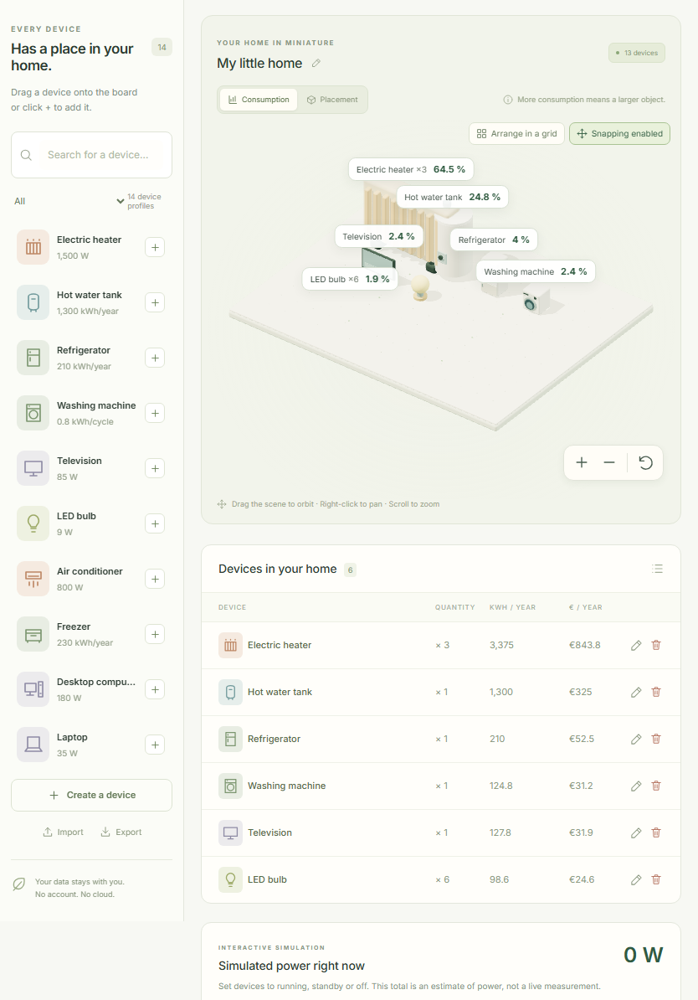
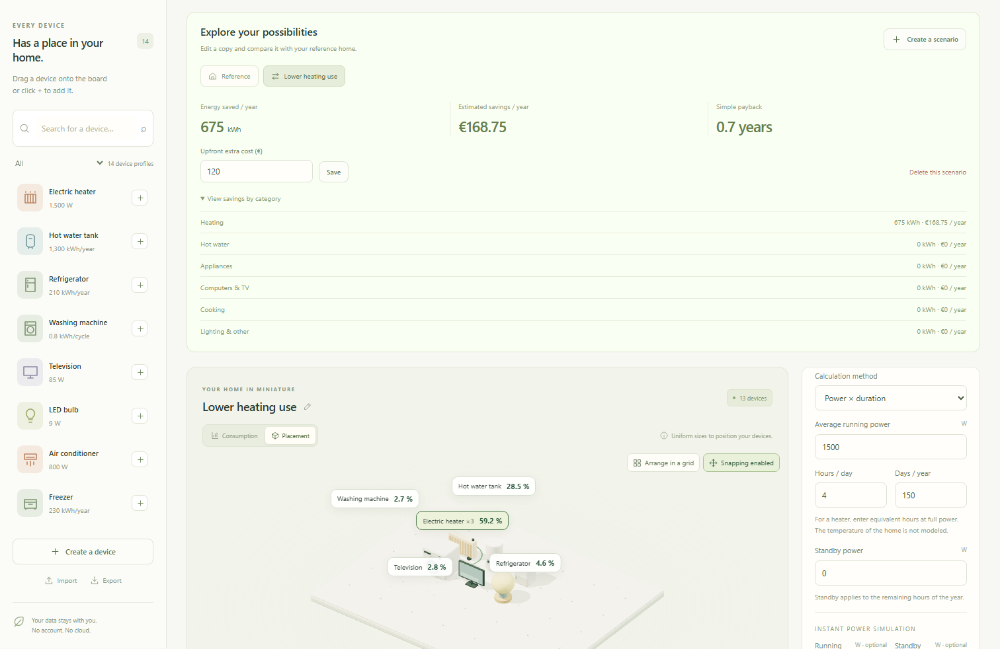
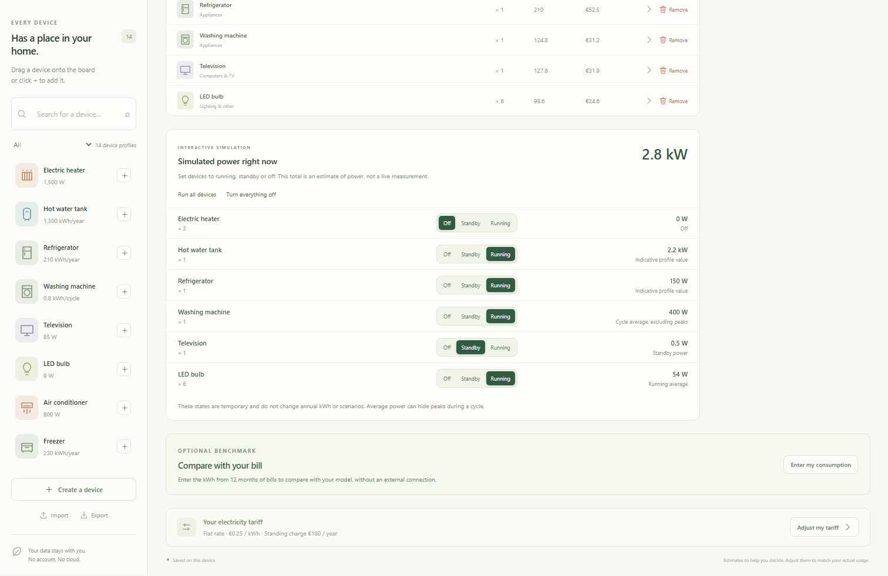
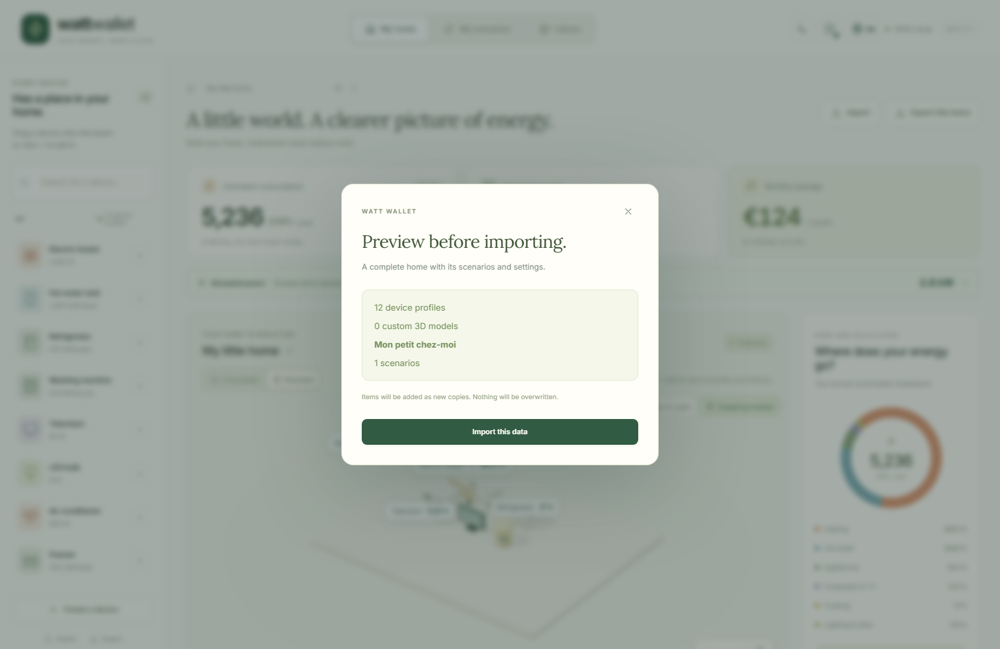

[English](../en/user-guide.md) · [Français](../fr/user-guide.md) · [Home](../../README.md)

# User guide

Watt Wallet estimates electricity use from the equipment and usage you enter. No meter, supplier account or online catalogue is needed. The demonstration profiles are starting points: adjust them to match your equipment and record the source of your numbers in the notes.

For formulas, see [Calculations and estimates](calculations.md). For development setup, see the [developer guide](development.md).

## Your first home

On the first launch, a demonstration home and 14 generic device profiles are created. The header lets you switch between **My home**, **My scenarios** and **Library**. Choose **English** with the globe button if the interface is in French.

Use the home selector to switch between saved homes, or its neighboring plus button to create an empty one. Rename the reference home with its pencil button. Each home has its own equipment, tariff and scenarios; the profile library is shared across the local workspace.

If you already have the Windows installer, run it, follow its French installation steps and launch Watt Wallet. WebView2 is downloaded only when missing; the unsigned installer and runtime coverage are described in the verification report.

Start with a few devices whose consumption you know. Set their usage, then use **Adjust my tariff** to enter your price per kWh and annual standing charge. The top cards show annual energy, the total annual electricity budget and its monthly average. They are estimates, not a supplier bill.

## Add, edit and remove devices

Search the library by name, brand or reference, and filter by category. Use the plus button to add a device, or drag its library entry onto the board. Click its object, label or name in the list to select the device. Use the pencil button on its row to bring the settings panel into view automatically. On mobile, the quick library sits immediately above the 3D board, after the annual estimates and simulated-power shortcut.

An installed device contains a copy of its profile. Set its name, quantity, calculation method, usage, off-peak share and notes, then select **Apply changes**. Editing a library profile later does not update copies already installed in homes or scenarios. To update an existing copy, edit that device's settings explicitly.

After applying a device's edits, **Save a copy to the library** makes a new reusable profile with its current usage as the default. It does not overwrite the original library profile.

A quantity such as six heaters remains one board object with a **×6** badge. It multiplies energy, costs and simulated power. Use separate objects when devices have different usage or when you want separate positions. **Duplicate** in the device panel creates another object with copied settings.

The trash action on each row is labelled **Remove from this scenario** or **Remove from home** according to the active configuration. The panel also has a removal action. Removing from a scenario leaves the reference intact, and removing an installed device does not delete its library profile. A library profile can be deleted separately; its installed copies remain.

## Create a reusable profile

In **Library**, select **New profile**, or use **Create a device** in the quick library. To modify an existing library profile, use its edit action.

In **Form**, enter a name, category and electrical characteristics. Brand and reference are optional. Choose one calculation method and its default usage. The rated power is descriptive: the annual calculation uses the average running power, cycle energy or annual energy you entered. Choose a built-in silhouette, or import a supported GLB; add a source or explanation in the notes.

The **JSON** tab edits a complete `DeviceDefinition`. It is available for library profiles, not for the usage editor of an installed device. Expand **View a complete JSON example** to inspect the expected structure. The live preview shows the profile and its estimated annual energy with the default usage.

Valid edits synchronize between the form and JSON. Syntax errors, missing fields and invalid values are reported separately from a valid profile. Invalid text is kept, and saving remains blocked even after returning to the form. Correct it or use **Reset JSON from the form** to discard the invalid JSON text. The app assigns the identifier at creation and keeps it when editing; changing `id` in the JSON does not replace that identity. See the [complete example and contract](wattpack.md#complete-device-profile).

JSON numbers use a decimal point, even in the French interface. Contract category values remain French. A custom GLB `assetId` must refer to an imported local resource: pasting JSON alone does not import model bytes.

## Organize and explore the board

| Mode            | What object size means                                                                                                                  |
| --------------- | --------------------------------------------------------------------------------------------------------------------------------------- |
| **Consumption** | The normalized bounding-box volume represents the device group's share of annual kWh. Linear scale follows the cube root of that share. |
| **Placement**   | Objects use uniform normalized sizes, making them easier to arrange.                                                                    |

The exact percentages remain in the labels and calculation results. Shapes have different proportions, so their visual dimensions are not real equipment dimensions. Zero-consumption objects remain small gray markers.

Use **Arrange in a grid** for centered rows with space between objects. Cell sizes follow the actual displayed X/Z dimensions, with a 0.45-unit gap. The board grows with the number, sizes and positions of objects. **Snapping** starts enabled; it moves a dragged device to the nearest free cell. Toggle it off for free placement. Positions are saved; board units are abstract, not metres.

| Input                                                  | Action                          |
| ------------------------------------------------------ | ------------------------------- |
| Drag empty board/background with the left mouse button | Orbit the camera.               |
| Drag with the right mouse button                       | Pan the view.                   |
| Mouse wheel or + / − buttons                           | Zoom.                           |
| Recenter button                                        | Restore the board framing.      |
| Drag a device                                          | Move that device.               |
| One finger on the background                           | Orbit on a touch screen.        |
| Two fingers                                            | Pan and zoom on a touch screen. |

You can also enter **Position X** and **Position Z** in the settings form. The list, buttons and forms provide the essential workflows without dragging. If WebGL is unavailable, use those controls to manage devices and estimates.

## Enter your tariff

Use **Adjust my tariff** for the active reference or scenario. Enter prices manually, including taxes, in the selected currency (EUR or USD).

- **Base:** one price per kWh.
- **Peak/off-peak:** separate peak and off-peak prices. Set **Off-peak consumption** on each device from 0 to 100%; its default is 0%.
- **Annual standing charge:** optional in practice; enter zero when excluding it.

The off-peak share applies to the device's full energy, including standby. Watt Wallet does not schedule cycles or detect off-peak hours. Standing charges enter the total budget but never the devices' energy shares. The monthly card is the annual total divided by twelve, not a prediction for a particular month's bill.

## Compare a scenario

Open **My scenarios**, then **Create a scenario**. This copies the devices, usage, positions and tariff of the currently displayed reference or scenario. Give it a descriptive name, then change the equipment, quantities, usage or tariff. Removing a device here affects only this copy.

Every scenario is compared with the **current reference** of its parent home. It is not compared with the scenario it was copied from. If the reference changes later, the comparison changes too.

Review savings in kWh/year and the selected currency per year, then expand **View savings by category**. Add an **Upfront extra cost (€)** and save it to estimate simple payback. Payback is shown only when annual savings are positive. There is no financing, depreciation or future tariff forecast in this calculation. A more expensive scenario can show negative savings. **Delete this scenario** removes the scenario without changing the reference.

For a heater, changing equivalent hours is an explicit usage assumption. The app cannot infer savings from a change in thermostat temperature, insulation or floor area.

## Simulate devices running now

Open **Simulated power right now**, or follow the power shortcut near the annual cards. Switch each device group between **Off**, **Standby** and **Running**; **Run all devices** and **Turn everything off** change the whole selection.

This indicative W/kW total is not a live reading and does not change annual kWh or costs. Running power uses an explicitly entered simulation value first, then average running power or cycle energy divided by cycle duration. Annual-energy profiles cannot supply running watts automatically. Standby uses its explicitly entered value or the profile's standby watts where available. Rated power is not substituted automatically.

Unknown power is flagged and excluded from the numeric total; it does not mean zero consumption. Enter the optional simulation watts in the profile or installed copy when needed. Each configuration keeps its own temporary switch selection for the session. States are not saved or exported and return to **Off** after restarting.

## Compare with your bills

In the category panel, use **Enter my consumption** to enter a positive kWh total covering twelve months of bills. The comparison always uses the home reference, even when a scenario is selected. It shows your observed total, the reference estimate and their difference.

The benchmark is saved and exported with the home. It does not automatically adjust equipment estimates or identify which device explains the difference. You can remove it from the same dialog. In device settings, **Understand this estimate** explains active energy, standby, quantity and cost.

## Personalize the interface

The moon/sun button changes light and dark mode. The first display follows the system theme; your explicit choice is saved locally. The palette button offers six colors and a custom selector, applied to the interface and 3D board in both modes. It also offers a return to the original green.

The globe button switches French/English without reloading and updates numeric formatting. Names and notes you wrote remain unchanged. The initial language is French, and your later choice is saved locally. Theme, color, language and currency preferences are not part of `.wattpack` exports.

The currency button next to the language selector offers **Euro (€), EUR** and **US dollar ($), USD**. Its choice applies immediately to all homes, scenarios, prices, estimated bills, savings and upfront costs, and is saved locally. It is independent from the language and theme. There is no exchange-rate conversion: choosing dollars keeps the entered numeric amounts unchanged. Review tariffs and costs before interpreting estimates in the new currency. When sharing a `.wattpack`, tell the recipient which currency to select; the V1 archive stores amounts without a currency code.

## Share and back up

| Export action            | What is included                                                                                          |
| ------------------------ | --------------------------------------------------------------------------------------------------------- |
| Export a library profile | That profile and its referenced custom model.                                                             |
| Export the library       | All library profiles and their referenced models.                                                         |
| **Export this home**     | The reference, all its scenarios, tariffs, positions, bill benchmark and embedded device profiles/models. |

A home export does not include unused library profiles, other homes or interface preferences. To back up the full workspace, export every home and the library. Keep files outside the application profile or browser storage.

Use **Import** to select a `.wattpack`. Validation and a preview happen before confirmation. Import creates new copies with remapped identifiers and leaves existing entries intact. Importing the same file again creates another copy; it does not merge or update previous imports. Only referenced models are packaged, once per resource.

The [example packages](../../examples/) can be imported to explore profiles, scenarios and a minimal custom model. Supported model files are standalone GLB 2 with embedded PNG/JPEG textures; see the [format limits](wattpack.md#visuals-and-glb-resources).

## Saving and recovery

Changes are saved automatically after an action is applied. An unsaved form draft still needs **Apply changes** or **Save profile**. Check the footer for **Saved on this device**, **Saving…** or a failure message before closing after a change.

Browser data uses IndexedDB for the current origin and browser profile. Another hostname, port, browser or profile has separate data; clearing site data can remove it. Windows uses its application data folder, separately from the browser. There is no cloud synchronization. Theme and language preferences use local storage.

For offline web use, first load the production application completely on localhost or HTTPS and allow its service worker to install. Reopen it on the same origin. The development server is not an offline install. The Windows app works offline, but installing a missing WebView2 runtime requires a connection.

## Troubleshooting

| Problem                                     | What to do                                                                                                                                                                                                     |
| ------------------------------------------- | -------------------------------------------------------------------------------------------------------------------------------------------------------------------------------------------------------------- |
| 3D is unavailable                           | Use the device list and forms. Check whether WebGL/hardware acceleration is available in the browser or WebView2 environment. Calculations do not require WebGL.                                               |
| JSON cannot be saved                        | Read the validation message. Check required fields, decimal points, field names, category values and usage bounds. Correct the text or reset from the form; invalid text is retained until then.               |
| Cycle/standby usage is rejected             | Give the cycle a positive duration when standby is nonzero and keep annual active hours within 8,760. See [Calculations](calculations.md).                                                                     |
| A `.wattpack` or GLB is refused             | Check version, size, missing resources and supported textures/compression against the [format guide](wattpack.md). Renaming a file does not make it compatible.                                                |
| Saving failed                               | Keep the window open. Export the current home/library where possible, resolve storage space or file-access issues, then use **Try again**. A retry keeps the same local copies instead of creating duplicates. |
| Another window changed the data             | Export local changes you want to keep, then use **Reload saved data** and confirm. Reload discards unsaved local changes; the app blocks stale writes rather than replacing the newer save.                    |
| Existing data cannot be loaded              | The app does not overwrite the unreadable save. Keep backups, resolve the storage issue and retry loading. Avoid clearing storage as a first recovery step.                                                    |
| Data seems missing on another device or URL | Local stores are separate. Import your exported home and library into the target environment.                                                                                                                  |
| The power total seems too low               | Check the flagged unknown powers and the selected states. Cycle power is an average, not an appliance's startup peak.                                                                                          |

There is no undo history or automatic external backup. GLB resources removed from profiles can remain locally; there is no compaction command in V1. See [verification and known limits](verification.md) for platform coverage and [all screenshot series](../screenshots/README.md) for more views.
