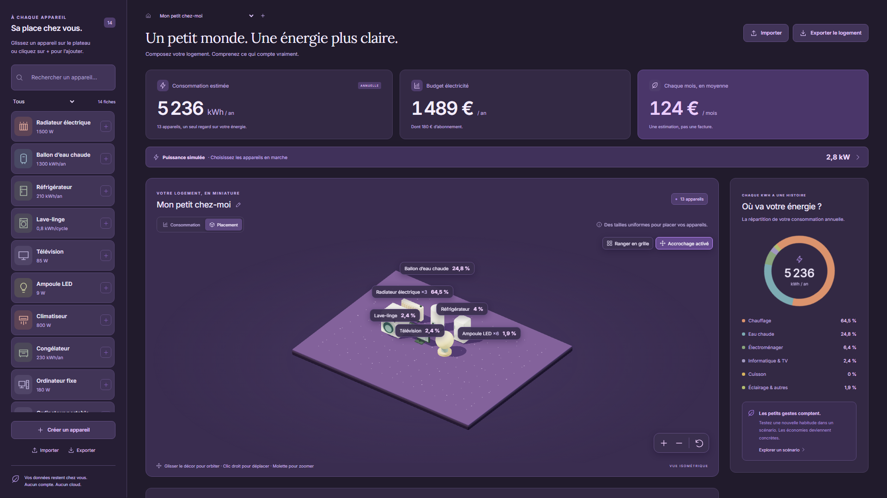

[English](../en/examples.md) · [Français](../fr/examples.md) · [Accueil](../../README.fr.md)

# Exemples et captures

## Paquets d’exemple importables

Télécharger un `.wattpack`, puis utiliser **Importer** dans Walletricity pour consulter l’aperçu et ajouter de nouvelles copies. Il s’agit de données de démonstration, pas de fiches officielles. Les imports ne remplacent pas les éléments existants.

| Paquet                                                                     | Contenu                                                                                                                        |
| -------------------------------------------------------------------------- | ------------------------------------------------------------------------------------------------------------------------------ |
| [Bibliothèque générique](../../examples/bibliotheque.wattpack)             | 14 fiches modifiables. [Lire le manifeste](../../examples/bibliotheque.manifest.json).                                         |
| [Logement et scénario](../../examples/logement.wattpack)                   | Appareils installés et scénario réduisant les heures de chauffage. [Lire le manifeste](../../examples/logement.manifest.json). |
| [Fiche avec GLB personnalisé](../../examples/modele-personnalise.wattpack) | Modèle triangulaire autonome minimal. [Télécharger le GLB](../../examples/triangle.glb).                                       |

Le [schéma JSON du manifeste](../wattpack.schema.json) et le [guide du format](wattpack.md) documentent le contrat et ses limites. Les noms et notes personnels de ces exemples conservent leur texte français d’origine à l’ouverture en anglais.

## Galeries des fonctionnalités

Chaque galerie contient 21 PNG de viewport : estimations annuelles, 3D, fiches/JSON, scénarios, puissance, tarifs, partage et thèmes.

| Disposition     | Dimensions  | Anglais                                               | Français                                                                |
| --------------- | ----------- | ----------------------------------------------------- | ----------------------------------------------------------------------- |
| iPad Pro 11″    | 834 × 1194  | [Ouvrir](../screenshots/ipad-pro-11/en/index.html)    | [Ouvrir](../screenshots/ipad-pro-11/fr/index.html)                      |
| MacBook Pro 14″ | 1512 × 982  | [Ouvrir](../screenshots/macbook-pro-14/en/index.html) | [Ouvrir](../screenshots/macbook-pro-14/fr/index.html)                   |
| Desktop         | 1920 × 1080 | [Ouvrir](../screenshots/desktop/en/index.html)        | [Ouvrir](../screenshots/desktop/fr/index.html)                          |
| iPhone 16 Pro   | 402 × 874   | Dernière vue anglaise dans la série historique        | [Ouvrir la galerie historique](../screenshots/iphone-16-pro/index.html) |

Ces captures utilisent Chromium et des données de démonstration isolées avec un ratio de pixels de 1. Elles montrent les dispositions responsives, sans validation sur appareils Apple physiques ou Safari. [Régénérer les séries](development.md#exemples-et-captures-fonctionnelles).

## Clair et sombre

Les préférences de thème appartiennent à l’application sur votre appareil. Le changement d’apparence de la documentation est indépendant.
