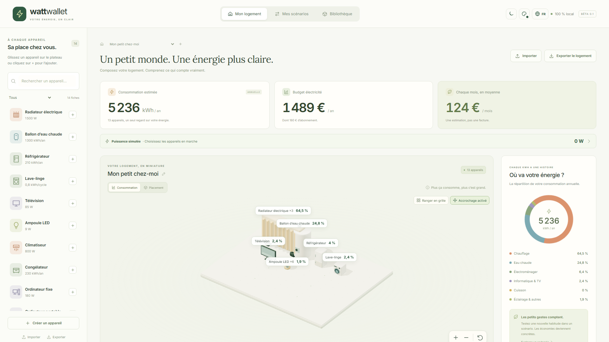

[English](../en/index.md) · [Français](../fr/index.md) · [Accueil](../../README.fr.md)

# Bienvenue dans Walletricity

**Composez votre logement. Comprenez ce qui consomme. Essayez des changements avant de les réaliser.**

Walletricity est un estimateur électrique local construit autour d’un logement miniature en 3D. Ajoutez vos appareils, renseignez leurs usages et votre tarif, puis comparez l’énergie et le coût annuels. Aucun compte, connexion fournisseur ou flux de données en direct n’est nécessaire.

## Commencer avec vos équipements

1. Ouvrir l’application et créer un logement, ou explorer celui de démonstration.
2. Ajouter des appareils depuis la bibliothèque modifiable et régler usages et quantités.
3. Saisir le prix par kWh et l’abonnement annuel.
4. Consulter l’estimation et créer un scénario pour essayer un changement.
5. Exporter le logement pour conserver une sauvegarde transportable.

[Suivre le guide utilisateur](user-guide.md#votre-premier-logement) ou [installer le projet localement](development.md#prérequis-et-installation).

## Explorer les fonctionnalités

| Fonctionnalité                                                                    | Possibilités                                                                                   |
| --------------------------------------------------------------------------------- | ---------------------------------------------------------------------------------------------- |
| [Appareils et quantités](user-guide.md#ajouter-modifier-et-retirer-des-appareils) | Regrouper les appareils identiques, les dupliquer et les retirer du logement ou d’un scénario. |
| [Fiches et JSON](user-guide.md#créer-une-fiche-réutilisable)                      | Créer des fiches réutilisables avec le formulaire ou l’éditeur JSON validé.                    |
| [Plateau 3D](user-guide.md#organiser-et-explorer-le-plateau)                      | Orbiter, zoomer, déplacer les appareils et organiser une grille adaptative.                    |
| [Tarifs](user-guide.md#renseigner-votre-tarif)                                    | Saisir les prix Base ou HP/HC et l’abonnement séparé.                                          |
| [Scénarios](user-guide.md#comparer-un-scénario)                                   | Comparer des configurations indépendantes, les économies et le retour simple.                  |
| [Puissance simulée](user-guide.md#simuler-les-appareils-allumés-maintenant)       | Passer les appareils en marche, veille ou arrêt pour un total temporaire en watts.             |
| [Repère de facture](user-guide.md#comparer-avec-vos-factures)                     | Comparer la référence à douze mois de consommation constatée.                                  |
| [Apparence](user-guide.md#personnaliser-linterface)                               | Choisir langue, mode clair/sombre et couleur.                                                  |
| [Partage](user-guide.md#partager-et-sauvegarder)                                  | Exporter et importer logement, scénarios ou bibliothèque avec leurs modèles personnalisés.     |

## Comprendre les chiffres

Les estimations annuelles utilisent la puissance moyenne et une durée, l’énergie par cycle ou une valeur annuelle renseignée. Le simulateur de puissance est séparé : ses états ne changent jamais les kWh annuels ou le budget. L’abonnement annuel entre dans le budget total sans intervenir dans les parts de consommation.

Les 14 fiches et les prix fournis sont des exemples modifiables, pas des caractéristiques officielles ou des tarifs fournisseur actuels. Les heures de chauffage sont des hypothèses explicites ; aucun modèle automatique de température, météo ou isolation n’est utilisé. [Comprendre les calculs](calculations.md).

## Conserver vos données localement

Les logements et fiches sont sauvegardés automatiquement sur cet appareil. Les stockages navigateur et Windows sont séparés ; il n’y a pas de synchronisation cloud. Utiliser les exports `.wattpack` pour transférer les données et conserver des sauvegardes. Le [guide utilisateur](user-guide.md#enregistrement-et-récupération) explique les échecs de stockage et conflits entre fenêtres.

La barre latérale mène à chaque fonctionnalité. La recherche locale retrouve les textes dans cette langue ; l’en-tête permet de changer de langue ou d’apparence. Les [exemples et captures](examples.md) proposent des téléchargements et d’autres vues. Pour le code, consulter le [guide développeur](development.md), le [format d’échange](wattpack.md) et le [guide des vérifications et limites](verification.md).
