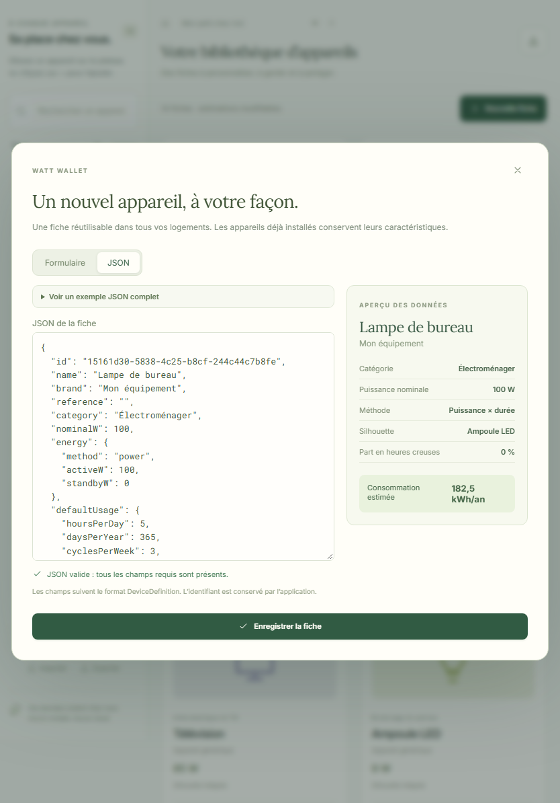
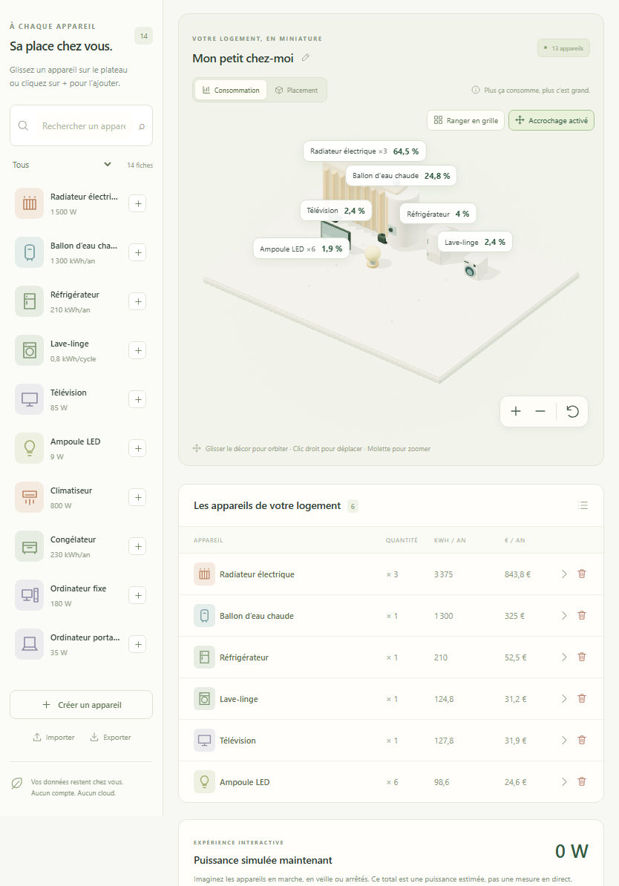
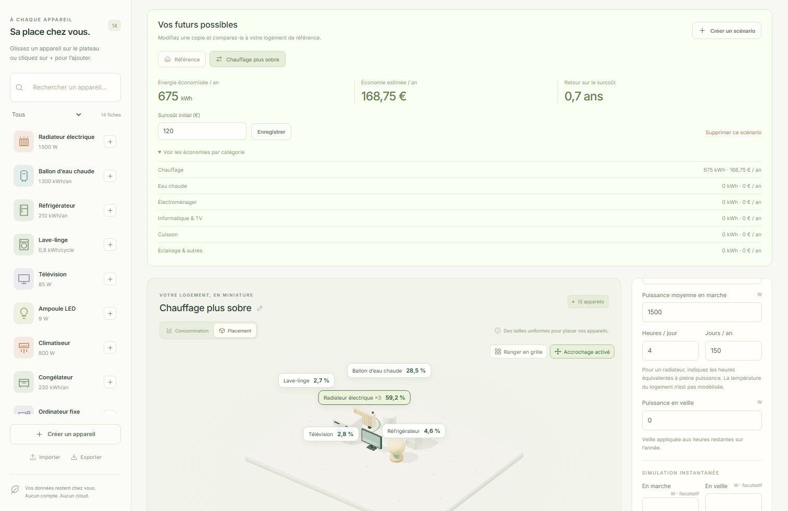
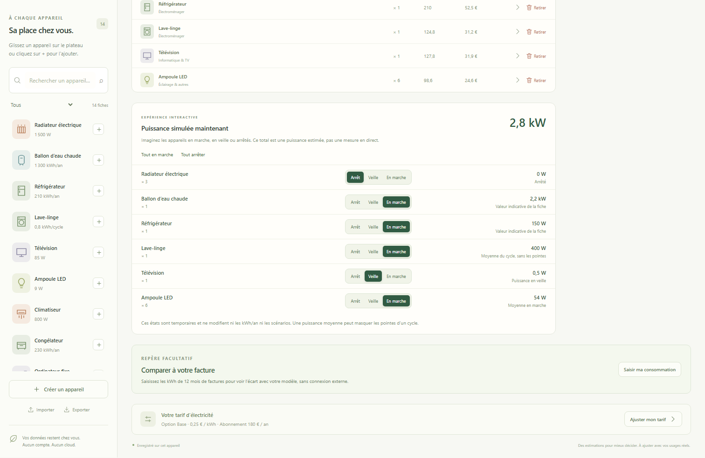

[English](../en/user-guide.md) · [Français](../fr/user-guide.md) · [Accueil](../../README.fr.md)

# Guide utilisateur

Watt Wallet estime la consommation électrique à partir des équipements et usages que vous renseignez. Aucun compteur, compte fournisseur ou catalogue en ligne n’est nécessaire. Les fiches de démonstration sont des points de départ : adaptez-les à votre équipement et indiquez la source de vos chiffres dans les notes.

Pour les formules, consulter [Calculs et estimations](calculations.md). Pour l’installation en développement, consulter le [guide développeur](development.md).

## Votre premier logement

Au premier lancement, un logement de démonstration et 14 fiches génériques sont créés. L’en-tête permet de passer entre **Mon logement**, **Mes scénarios** et **Bibliothèque**. Choisir **Français** avec le bouton globe si l’interface est en anglais.

Utiliser le sélecteur de logement pour passer entre les logements sauvegardés, ou le bouton plus voisin pour en créer un vide. Le crayon permet de renommer le logement de référence. Chaque logement possède ses équipements, son tarif et ses scénarios ; la bibliothèque est partagée dans l’espace de travail local.

Si vous disposez déjà de l’installateur Windows, l’exécuter, suivre ses étapes en français puis lancer Watt Wallet. WebView2 est téléchargé uniquement s’il manque ; le rapport de vérification précise la signature et la couverture de ce parcours.

Commencer par quelques appareils dont vous connaissez la consommation. Régler leurs usages, puis utiliser **Ajuster mon tarif** pour saisir votre prix par kWh et votre abonnement annuel. Les cartes principales affichent l’énergie annuelle, le budget électrique annuel total et sa moyenne mensuelle. Il s’agit d’estimations, pas d’une facture fournisseur.

## Ajouter, modifier et retirer des appareils

Rechercher une fiche par nom, marque ou référence et filtrer par catégorie. Utiliser le bouton plus pour ajouter un appareil, ou glisser sa fiche sur le plateau. Cliquer sur l’objet, son étiquette ou sa ligne pour ouvrir les paramètres.

Un appareil installé contient une copie de sa fiche. Renseigner son nom, sa quantité, sa méthode de calcul, ses usages, sa part en heures creuses et ses notes, puis choisir **Appliquer les modifications**. Modifier ensuite la fiche de bibliothèque ne met pas à jour les copies déjà installées dans les logements ou scénarios. Pour actualiser une copie existante, modifier explicitement les paramètres de cet appareil.

Après application des modifications, **Enregistrer une copie dans la bibliothèque** crée une nouvelle fiche réutilisable avec l’usage courant comme usage par défaut. Cette action ne remplace pas la fiche de bibliothèque d’origine.

Une quantité de six radiateurs reste un seul objet avec un badge **×6**. Elle multiplie l’énergie, le coût et la puissance simulée. Utiliser des objets séparés pour des usages différents ou des positions distinctes. **Dupliquer** dans le panneau crée un autre objet avec les mêmes réglages.

L’action corbeille sur chaque ligne est nommée **Retirer de ce scénario** ou **Retirer du logement** selon la configuration active. Le panneau propose aussi le retrait. Retirer un appareil d’un scénario laisse la référence intacte, et retirer un appareil installé ne supprime pas sa fiche de bibliothèque. Une fiche peut être supprimée séparément ; ses copies installées restent présentes.

## Créer une fiche réutilisable

Dans **Bibliothèque**, choisir **Nouvelle fiche**, ou utiliser **Créer un appareil** dans la bibliothèque rapide. Pour modifier une fiche existante, utiliser son action d’édition.

Dans **Formulaire**, saisir le nom, la catégorie et les caractéristiques électriques. Marque et référence sont facultatives. Choisir une méthode de calcul et son usage par défaut. La puissance nominale est descriptive : le calcul annuel utilise la puissance moyenne, l’énergie par cycle ou l’énergie annuelle renseignée. Choisir une silhouette intégrée ou importer un GLB compatible ; ajouter la source ou une explication dans les notes.

L’onglet **JSON** édite une `DeviceDefinition` complète. Il concerne les fiches de bibliothèque, pas l’éditeur d’usage d’un appareil installé. Déplier **Voir un exemple JSON complet** pour consulter la structure attendue. L’aperçu affiche la fiche et son estimation annuelle selon l’usage par défaut.

Les modifications valides se synchronisent entre formulaire et JSON. Les erreurs de syntaxe, champs manquants et valeurs invalides sont distingués d’une fiche valide. Le texte invalide est conservé, et l’enregistrement reste bloqué même après retour au formulaire. Le corriger ou utiliser **Réinitialiser le JSON depuis le formulaire** pour abandonner le texte invalide. L’application attribue l’identifiant à la création et le conserve à l’édition ; changer `id` dans le JSON ne remplace pas cette identité. Voir l’[exemple complet et le contrat](wattpack.md#fiche-dappareil-complète).

Les nombres JSON utilisent un point décimal, même dans l’interface française. Les catégories du contrat restent en français. Un `assetId` de GLB doit correspondre à une ressource locale importée : coller du JSON n’importe pas les octets du modèle.

## Organiser et explorer le plateau

| Mode             | Signification de la taille                                                                                                                         |
| ---------------- | -------------------------------------------------------------------------------------------------------------------------------------------------- |
| **Consommation** | Le volume de la boîte englobante normalisée représente la part des kWh annuels du groupe. L’échelle linéaire suit la racine cubique de cette part. |
| **Placement**    | Les objets ont des tailles normalisées uniformes pour faciliter le rangement.                                                                      |

Les pourcentages exacts restent dans les étiquettes et les résultats de calcul. Les formes ont des proportions différentes ; leurs dimensions visuelles ne représentent pas les dimensions réelles des appareils. Les objets à consommation nulle restent de petits repères gris.

Utiliser **Ranger en grille** pour obtenir des lignes centrées et espacées. Les cellules suivent les dimensions X/Z réellement affichées, avec une marge de 0,45 unité. Le plateau grandit selon le nombre, la taille et la position des objets. L’**Accrochage** démarre activé et place l’appareil déplacé dans la cellule libre la plus proche. Le désactiver pour un placement libre. Les positions sont sauvegardées ; les unités du plateau sont abstraites, pas des mètres.

| Geste                                                         | Action                                       |
| ------------------------------------------------------------- | -------------------------------------------- |
| Glisser sur le plateau vide ou le décor avec le bouton gauche | Orbiter autour du logement.                  |
| Glisser avec le bouton droit                                  | Déplacer la vue.                             |
| Molette ou boutons + / −                                      | Zoomer.                                      |
| Bouton de recentrage                                          | Rétablir le cadrage du plateau.              |
| Glisser un appareil                                           | Déplacer cet appareil.                       |
| Un doigt sur le décor                                         | Orbiter sur écran tactile.                   |
| Deux doigts                                                   | Déplacer la vue et zoomer sur écran tactile. |

Les champs **Position X** et **Position Z** permettent aussi le placement dans le formulaire. La liste, les boutons et les formulaires donnent accès aux opérations essentielles sans glisser-déposer. Si WebGL est indisponible, utiliser ces commandes pour gérer appareils et estimations.

## Renseigner votre tarif

Utiliser **Ajuster mon tarif** pour la référence ou le scénario actif. Tous les prix sont saisis manuellement en euros TTC.

- **Base :** un prix par kWh.
- **Heures pleines / creuses :** deux prix distincts. Régler **Consommation en heures creuses** sur chaque appareil entre 0 et 100 % ; la valeur initiale est 0 %.
- **Abonnement annuel :** facultatif en pratique ; saisir zéro pour l’exclure.

La part en heures creuses s’applique à toute l’énergie de l’appareil, veille incluse. Watt Wallet ne programme pas les cycles et ne détecte pas les heures creuses. L’abonnement entre dans le budget total mais jamais dans les parts de consommation. La carte mensuelle est le total annuel divisé par douze, pas la prévision d’une facture pour un mois précis.

## Comparer un scénario

Ouvrir **Mes scénarios**, puis **Créer un scénario**. Cette action copie les appareils, usages, positions et tarif de la référence ou du scénario actuellement affiché. Donner un nom explicite, puis modifier les équipements, quantités, usages ou tarif. Retirer un appareil ici ne touche que cette copie.

Chaque scénario est comparé à la **référence actuelle** de son logement parent, et non au scénario dont il est issu. Si la référence change ensuite, la comparaison change aussi.

Consulter les économies en kWh/an et €/an, puis déplier **Voir les économies par catégorie**. Renseigner un **Surcoût initial (€)** et l’enregistrer pour estimer le retour simple. Le retour apparaît uniquement si les économies annuelles sont positives. Le calcul n’intègre ni financement, ni amortissement, ni prévision de tarif. Un scénario plus coûteux peut afficher des économies négatives. **Supprimer ce scénario** retire le scénario sans modifier la référence.

Pour un radiateur, changer les heures équivalentes constitue une hypothèse d’usage explicite. L’application ne déduit pas les économies d’un changement de température, d’isolation ou de surface.

## Simuler les appareils allumés maintenant

Ouvrir **Puissance simulée maintenant**, ou suivre le raccourci de puissance près des cartes annuelles. Passer chaque groupe entre **Arrêt**, **Veille** et **En marche** ; **Tout en marche** et **Tout arrêter** modifient toute la sélection.

Ce total indicatif en W/kW ne provient pas d’une mesure en direct et ne change pas les kWh annuels ni les coûts. La puissance en marche utilise d’abord une valeur de simulation explicite, puis la puissance moyenne en marche ou l’énergie d’un cycle divisée par sa durée. Une fiche en consommation annuelle ne permet pas de déduire automatiquement les watts en marche. La veille utilise sa valeur explicite ou les watts de veille de la fiche lorsqu’ils sont disponibles. La puissance nominale n’est pas utilisée automatiquement à leur place.

Une puissance inconnue est signalée et exclue du total numérique ; elle ne signifie pas une consommation nulle. Renseigner au besoin les watts facultatifs de simulation dans la fiche ou la copie installée. Chaque configuration conserve sa sélection temporaire pendant la session. Ces états ne sont ni sauvegardés ni exportés et reviennent à **Arrêt** après redémarrage.

## Comparer avec vos factures

Dans le panneau de répartition, utiliser **Saisir ma consommation** pour renseigner un total positif de kWh couvrant douze mois de factures. La comparaison utilise toujours la référence du logement, même si un scénario est sélectionné. Elle affiche le total constaté, l’estimation de référence et leur différence.

Le repère est sauvegardé et exporté avec le logement. Il ne corrige pas automatiquement les estimations et n’identifie pas l’appareil responsable de l’écart. Il peut être retiré depuis la même fenêtre. Dans les paramètres d’un appareil, **Comprendre cette estimation** détaille fonctionnement, veille, quantité et coût.

## Personnaliser l’interface

Le bouton lune/soleil change le mode clair ou sombre. Le premier affichage suit le thème système ; le choix explicite est ensuite conservé localement. La palette propose six couleurs et un sélecteur personnalisé, appliqués à l’interface et au plateau dans les deux modes. Elle permet aussi de revenir au vert d’origine.

Le bouton globe change la langue sans rechargement et adapte les formats numériques. Vos noms et notes restent inchangés. La langue initiale est le français, puis votre choix est conservé localement. Les préférences de thème, couleur et langue ne font pas partie des exports `.wattpack`.

## Partager et sauvegarder

| Action d’export                    | Contenu                                                                                                        |
| ---------------------------------- | -------------------------------------------------------------------------------------------------------------- |
| Exporter une fiche de bibliothèque | Cette fiche et son modèle personnalisé référencé.                                                              |
| Exporter la bibliothèque           | Toutes les fiches et leurs modèles référencés.                                                                 |
| **Partager le logement**           | La référence, tous ses scénarios, tarifs, positions, repère de facture et copies de fiches/modèles embarquées. |

Un export de logement ne contient ni les fiches inutilisées de la bibliothèque, ni les autres logements, ni les préférences d’interface. Pour sauvegarder tout l’espace de travail, exporter chaque logement et la bibliothèque. Conserver les fichiers hors du profil applicatif ou du stockage du navigateur.

Utiliser **Importer** pour sélectionner un `.wattpack`. La validation et l’aperçu précèdent la confirmation. L’import crée de nouvelles copies avec identifiants remappés et conserve les éléments existants. Importer à nouveau le même fichier crée une autre copie ; il ne fusionne pas et n’actualise pas les imports précédents. Seuls les modèles référencés sont embarqués, une fois par ressource.

Les [paquets d’exemple](../../examples/) permettent d’explorer les fiches, scénarios et un modèle personnalisé minimal. Les modèles acceptés sont des GLB 2 autonomes avec textures PNG/JPEG embarquées ; consulter les [limites du format](wattpack.md#visuels-et-ressources-glb).

## Enregistrement et récupération

Les modifications sont sauvegardées automatiquement après application d’une action. Un brouillon de formulaire nécessite encore **Appliquer les modifications** ou **Enregistrer la fiche**. Vérifier le pied de page : **Enregistré sur cet appareil**, **Enregistrement…** ou message d’échec, avant de fermer après une modification.

Le navigateur utilise IndexedDB pour l’origine et le profil actuels. Une autre adresse, un autre port, navigateur ou profil possède des données séparées ; effacer les données du site peut les supprimer. Windows utilise son dossier applicatif, séparément du navigateur. Il n’y a aucune synchronisation cloud. Thème et langue utilisent le stockage local des préférences.

Pour le web hors connexion, charger d’abord complètement l’application de production sur localhost ou HTTPS et laisser son service worker s’installer. La rouvrir sur la même origine. Le serveur de développement ne constitue pas une installation hors connexion. L’application Windows fonctionne hors connexion, mais installer WebView2 s’il manque nécessite une connexion.

## Dépannage

| Problème                                                             | Action                                                                                                                                                                                                                                                                 |
| -------------------------------------------------------------------- | ---------------------------------------------------------------------------------------------------------------------------------------------------------------------------------------------------------------------------------------------------------------------- |
| La 3D est indisponible                                               | Utiliser la liste et les formulaires. Vérifier la disponibilité de WebGL et de l’accélération matérielle dans le navigateur ou WebView2. Les calculs n’exigent pas WebGL.                                                                                              |
| Le JSON ne peut pas être enregistré                                  | Lire le diagnostic. Vérifier les champs requis, points décimaux, noms de champs, catégories et bornes d’usage. Corriger ou réinitialiser depuis le formulaire ; le texte invalide reste conservé jusque-là.                                                            |
| L’usage par cycle ou la veille est refusé                            | Donner une durée positive au cycle si la veille est non nulle et ne pas dépasser 8 760 heures actives annuelles. Voir les [calculs](calculations.md).                                                                                                                  |
| Un `.wattpack` ou GLB est refusé                                     | Vérifier version, taille, ressources manquantes, textures et compressions acceptées dans le [guide du format](wattpack.md). Renommer un fichier ne le rend pas compatible.                                                                                             |
| La sauvegarde échoue                                                 | Garder la fenêtre ouverte. Exporter le logement ou la bibliothèque si possible, résoudre les problèmes d’espace ou d’accès aux fichiers, puis utiliser **Réessayer**. La reprise conserve les mêmes copies locales sans créer de doublons.                             |
| Une autre fenêtre a modifié les données                              | Exporter les modifications locales à conserver, puis choisir **Recharger les données** et confirmer. Le rechargement abandonne les modifications locales non sauvegardées ; l’application bloque les écritures périmées plutôt que de remplacer la sauvegarde récente. |
| Des données existantes ne se chargent pas                            | L’application n’écrase pas la sauvegarde illisible. Conserver les sauvegardes externes, résoudre le problème de stockage et retenter le chargement. Éviter d’effacer le stockage comme première tentative de récupération.                                             |
| Les données semblent absentes sur un autre appareil ou une autre URL | Les stockages locaux sont séparés. Importer le logement et la bibliothèque exportés dans l’environnement cible.                                                                                                                                                        |
| Le total de puissance paraît trop faible                             | Vérifier les puissances inconnues et les états sélectionnés. La puissance par cycle est une moyenne, pas la pointe de démarrage de l’appareil.                                                                                                                         |

Il n’y a pas d’historique d’annulation ni de sauvegarde externe automatique. Les GLB retirés des fiches peuvent rester localement ; la V1 ne propose pas de compactage. Consulter les [vérifications et limites connues](verification.md) pour la couverture des plateformes et [toutes les captures](../screenshots/README.md) pour d’autres vues.
